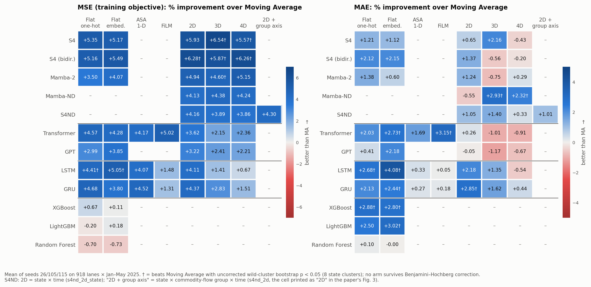
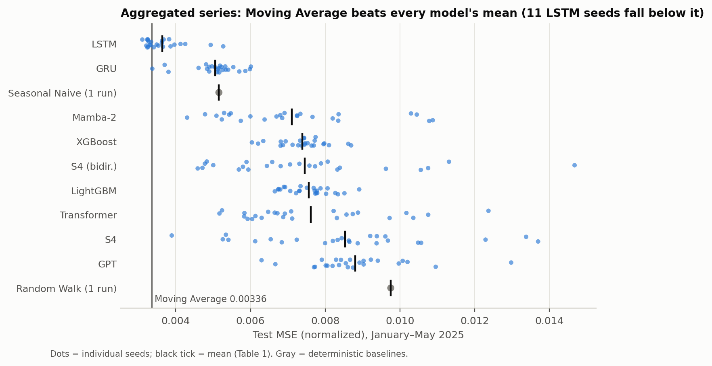
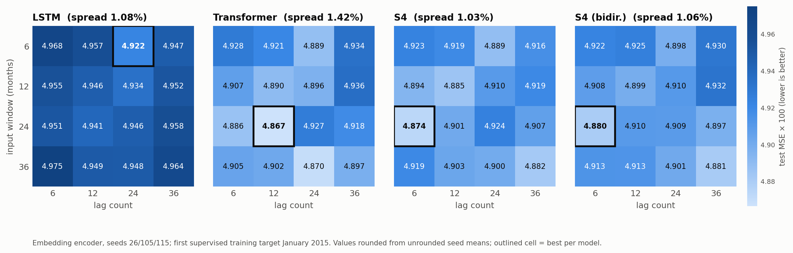
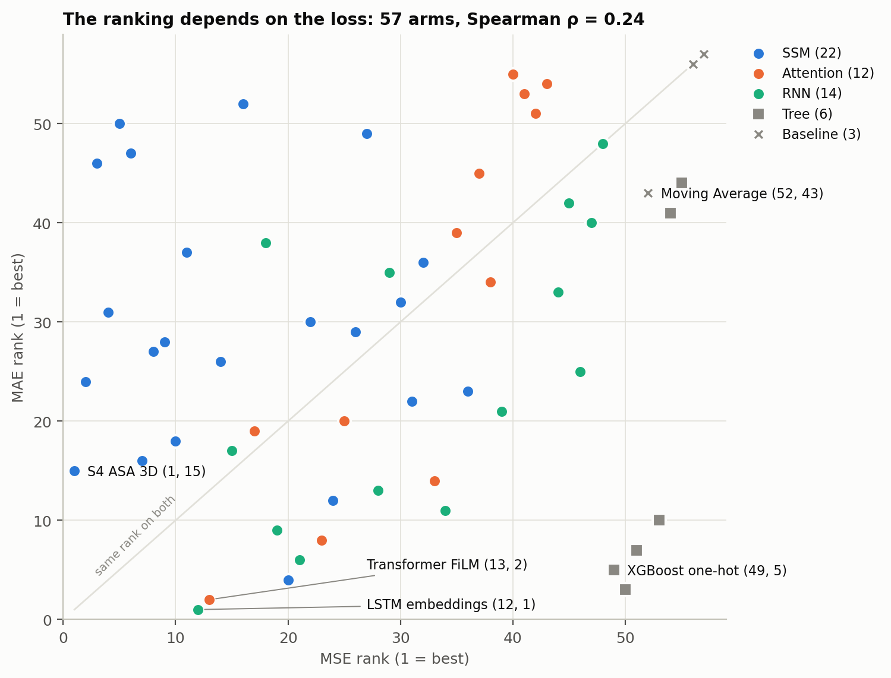

# Findings

Every number on this page is generated by `tools/build_findings.py` from the run files in [`results/2026-10-26/`](../results/2026-10-26/) via `tools/recompute_results.py`. The recomputation re-derives the metrics of all **769 runs** from their `predictions.csv` (largest difference from the stored `metrics.json`: 1.4e-14). The seed means, ranks, MASE (from the raw dataset), significance tests (own wild-cluster implementation) and SHAP shares are rebuilt from those runs too. The paper-claim ledger is in [`paper_audit/`](paper_audit/).

## Headline

- **Aggregated series (Part 1):** Moving Average has the lowest error on every metric (MSE 0.003362). LSTM is next, 8.38% higher in MSE, although 11 of its 25 seeds individually beat Moving Average.
- **Multidimensional panel (Part 3):** the best arm is **S4 ASA 3D**, with MSE 0.048726, 6.54% below Moving Average. SSM 2D–4D arms hold the top six MSE ranks. All 48 neural arms beat Moving Average on MSE, but on MAE Moving Average beats 11 of them.
- **No arm is significantly better than Moving Average after correction.** The smallest Benjamini–Hochberg q over all 108 comparisons is 0.084 (S4 ASA 3D: raw p = 0.0078, q = 0.152).
- **The ranking depends on the loss.** The Spearman correlation between MSE rank and MAE rank across the 57 arms is 0.24. S4 ASA 3D is 1st on MSE but 15th on MAE; LSTM embeddings is 12th and 1st.
- **Windows and lags matter little (Part 2):** the best-to-worst spread within each model is LSTM 1.08%, S4 1.03%, S4 (bidir.) 1.06%, Transformer 1.42%.

## Data and protocol

| Item | Value |
|---|---|
| Months | 197 (January 2009 – May 2025) |
| States | 8 |
| State × commodity × flow lanes in the grid | 1542 |
| Lanes kept (≤5% zero months over the 180 training months) | 918 |
| Commodities kept (HS2) | 93 |
| Lattice density | 61.69% |
| Train / validation / test | ≤ 2023-12 / 2024 / 2025-01 … 2025-05 (test = 918 lanes × 5 months) |
| Window-lag sweep exception | first supervised training target January 2015 (all 192 runs) |
| Neural settings | 4 layers, width 128, dropout 0.1, AdamW (lr 1e-4, weight decay 1e-4), grad clip 1.0 |
| Neural parameter counts (Part 3) | 180,326 – 966,018 |
| Seeds | Part 1: 25 per learned model; Parts 2–3: 26, 105, 115 |
| Targets | imports: generic vessel value/weight; exports: containerized vessel value/weight |
| Metrics | MSE / MAE / RMSE on per-lane min-max normalized value and weight (averaged); sMAPE in real units; MASE against each lane's 12-month seasonal-naive training error |

## Part 1 — aggregated series

| Model | Runs | MAE | MSE | RMSE | sMAPE % |
|---|---:|---:|---:|---:|---:|
| Moving Average | 1 | 0.049249 | 0.003362 | 0.057926 | 4.79 |
| LSTM | 25 | 0.052776 | 0.003644 | 0.059891 | 5.07 |
| GRU | 25 | 0.060117 | 0.005053 | 0.070025 | 5.71 |
| Seasonal Naive | 1 | 0.056541 | 0.005155 | 0.071456 | 5.30 |
| Mamba-2 | 25 | 0.068697 | 0.007111 | 0.082209 | 6.28 |
| XGBoost | 25 | 0.068681 | 0.007382 | 0.085459 | 6.57 |
| S4 (bidir.) | 25 | 0.071315 | 0.007453 | 0.084737 | 6.88 |
| LightGBM | 25 | 0.071998 | 0.007559 | 0.086100 | 6.74 |
| Transformer | 25 | 0.071970 | 0.007617 | 0.085212 | 7.06 |
| S4 | 25 | 0.077508 | 0.008537 | 0.090703 | 7.49 |
| GPT | 25 | 0.078412 | 0.008799 | 0.091948 | 7.76 |
| Random Walk | 1 | 0.089069 | 0.009755 | 0.098730 | 8.96 |

These are the paper's Table 1 values; all 48 cells match.

### Linear head vs MLP head (paper Fig. 1)

| Model | MSE, linear head | MSE, MLP head (128→64→2) | Δ MSE | Δ MAE |
|---|---:|---:|---:|---:|
| LSTM | 0.003644 | 0.013555 | +272.0% | +68.4% |
| GRU | 0.005053 | 0.004691 | -7.2% | -2.5% |
| Transformer | 0.007617 | 0.004902 | -35.6% | -19.2% |
| Mamba-2 | 0.007111 | 0.006151 | -13.5% | -5.8% |
| GPT | 0.008799 | 0.006196 | -29.6% | -17.3% |
| S4 (bidir.) | 0.007453 | 0.006977 | -6.4% | -3.6% |
| S4 | 0.008537 | 0.007243 | -15.2% | -10.7% |

LSTM's deterioration is significant for MSE (exact paired Wilcoxon over 25 seeds, p = 0.0051; 18/25 seeds worse) but not for MAE (p = 0.411; 12/25 worse).

## Part 2 — window × lag sweep (embedding encoder)

Normalized test MSE × 100, mean of three seeds. Rows are the input window and columns the lag count, both in months.

**LSTM**

| window \ lags | 6 | 12 | 24 | 36 |
|---:|---:|---:|---:|---:|
| 6 | 4.968 | 4.957 | 4.922 | 4.947 |
| 12 | 4.955 | 4.946 | 4.934 | 4.952 |
| 24 | 4.951 | 4.941 | 4.946 | 4.958 |
| 36 | 4.975 | 4.949 | 4.948 | 4.964 |

**S4**

| window \ lags | 6 | 12 | 24 | 36 |
|---:|---:|---:|---:|---:|
| 6 | 4.923 | 4.919 | 4.889 | 4.916 |
| 12 | 4.894 | 4.885 | 4.910 | 4.919 |
| 24 | 4.874 | 4.901 | 4.924 | 4.907 |
| 36 | 4.919 | 4.903 | 4.900 | 4.882 |

**S4 (bidir.)**

| window \ lags | 6 | 12 | 24 | 36 |
|---:|---:|---:|---:|---:|
| 6 | 4.922 | 4.925 | 4.898 | 4.930 |
| 12 | 4.908 | 4.899 | 4.910 | 4.932 |
| 24 | 4.880 | 4.910 | 4.909 | 4.897 |
| 36 | 4.913 | 4.913 | 4.901 | 4.881 |

**Transformer**

| window \ lags | 6 | 12 | 24 | 36 |
|---:|---:|---:|---:|---:|
| 6 | 4.928 | 4.921 | 4.889 | 4.934 |
| 12 | 4.907 | 4.890 | 4.896 | 4.936 |
| 24 | 4.886 | 4.867 | 4.927 | 4.918 |
| 36 | 4.905 | 4.902 | 4.870 | 4.897 |

## Part 3 — multidimensional panel (57 arms × 3 seeds)

Δ is the % improvement over Moving Average (positive = better). p is the two-sided wild-cluster bootstrap over 8 state clusters, with all 256 sign patterns enumerated. q is the Benjamini–Hochberg adjustment within each metric's 54 comparisons. † marks a raw p < 0.05 in the improving direction.

| MSE rank | Arm | Family | MSE | Δ MSE % | p / q (MSE) | MAE rank | MAE | Δ MAE % | p / q (MAE) | MASE |
|---:|---|---|---:|---:|---:|---:|---:|---:|---:|---:|
| 1 | S4 · ASA 3D | SSM | 0.048726 | +6.54† | 0.0078 / 0.152 | 15 | 0.112817 | +2.16 | 0.0781 / 0.248 | 0.862 |
| 2 | S4 (bidir.) · ASA 2D | SSM | 0.048861 | +6.28† | 0.0234 / 0.152 | 24 | 0.113729 | +1.37 | 0.3438 / 0.599 | 0.870 |
| 3 | S4 (bidir.) · ASA 4D | SSM | 0.048872 | +6.26† | 0.0312 / 0.152 | 46 | 0.115534 | -0.20 | 0.8594 / 0.937 | 0.890 |
| 4 | S4 · ASA 2D | SSM | 0.049045 | +5.93 | 0.0547 / 0.152 | 31 | 0.114559 | +0.65 | 0.5938 / 0.867 | 0.877 |
| 5 | S4 (bidir.) · ASA 3D | SSM | 0.049077 | +5.87† | 0.0312 / 0.152 | 50 | 0.115953 | -0.56 | 0.5703 / 0.855 | 0.894 |
| 6 | S4 · ASA 4D | SSM | 0.049231 | +5.57† | 0.0312 / 0.152 | 47 | 0.115794 | -0.43 | 0.6484 / 0.873 | 0.891 |
| 7 | S4 (bidir.) · flat embeddings | SSM | 0.049272 | +5.49 | 0.0547 / 0.152 | 16 | 0.112830 | +2.15 | 0.1250 / 0.375 | 0.855 |
| 8 | S4 · flat one-hot | SSM | 0.049345 | +5.35 | 0.0703 / 0.152 | 27 | 0.113904 | +1.21 | 0.4219 / 0.670 | 0.869 |
| 9 | S4 · flat embeddings | SSM | 0.049442 | +5.17 | 0.0703 / 0.152 | 28 | 0.114009 | +1.12 | 0.4922 / 0.759 | 0.867 |
| 10 | S4 (bidir.) · flat one-hot | SSM | 0.049447 | +5.16 | 0.0703 / 0.152 | 18 | 0.112857 | +2.12 | 0.1406 / 0.380 | 0.855 |
| 11 | Mamba-2 · ASA 4D | SSM | 0.049449 | +5.15 | 0.0625 / 0.152 | 37 | 0.114974 | +0.29 | 0.8203 / 0.932 | 0.880 |
| 12 | LSTM · flat embeddings | RNN | 0.049505 | +5.05† | 0.0312 / 0.152 | 1 | 0.110600 | +4.08† | 0.0078 / 0.084 | 0.830 |
| 13 | Transformer · FiLM | Attention | 0.049519 | +5.02 | 0.0547 / 0.152 | 2 | 0.111674 | +3.15† | 0.0234 / 0.158 | 0.841 |
| 14 | Mamba-2 · ASA 2D | SSM | 0.049561 | +4.94 | 0.0547 / 0.152 | 26 | 0.113875 | +1.24 | 0.2422 / 0.562 | 0.869 |
| 15 | GRU · flat one-hot | RNN | 0.049696 | +4.68 | 0.0703 / 0.152 | 17 | 0.112850 | +2.13 | 0.0547 / 0.211 | 0.853 |
| 16 | Mamba-2 · ASA 3D | SSM | 0.049738 | +4.60† | 0.0469 / 0.152 | 52 | 0.116173 | -0.75 | 0.4062 / 0.665 | 0.891 |
| 17 | Transformer · flat one-hot | Attention | 0.049752 | +4.57 | 0.0625 / 0.152 | 19 | 0.112961 | +2.03 | 0.0547 / 0.211 | 0.853 |
| 18 | GRU · ASA 1-D | RNN | 0.049781 | +4.52 | 0.0703 / 0.152 | 38 | 0.114995 | +0.27 | 0.7812 / 0.917 | 0.878 |
| 19 | LSTM · flat one-hot | RNN | 0.049835 | +4.41† | 0.0391 / 0.152 | 9 | 0.112215 | +2.68† | 0.0078 / 0.084 | 0.847 |
| 20 | Mamba-ND · 3D | SSM | 0.049855 | +4.38 | 0.0703 / 0.152 | 4 | 0.111926 | +2.93† | 0.0234 / 0.158 | 0.846 |
| 21 | GRU · ASA 2D | RNN | 0.049857 | +4.37 | 0.0547 / 0.152 | 6 | 0.112023 | +2.85† | 0.0234 / 0.158 | 0.845 |
| 22 | S4ND · 2D + group axis | SSM | 0.049893 | +4.30 | 0.0703 / 0.152 | 30 | 0.114136 | +1.01 | 0.2969 / 0.573 | 0.868 |
| 23 | Transformer · flat embeddings | Attention | 0.049906 | +4.28 | 0.0703 / 0.152 | 8 | 0.112160 | +2.73† | 0.0078 / 0.084 | 0.842 |
| 24 | Mamba-ND · 4D | SSM | 0.049928 | +4.24 | 0.1016 / 0.189 | 12 | 0.112633 | +2.32† | 0.0391 / 0.192 | 0.855 |
| 25 | Transformer · ASA 1-D | Attention | 0.049960 | +4.17 | 0.1016 / 0.189 | 20 | 0.113356 | +1.69 | 0.2500 / 0.562 | 0.855 |
| 26 | S4ND · 2D (state × time) | SSM | 0.049970 | +4.16 | 0.1094 / 0.191 | 29 | 0.114088 | +1.05 | 0.3438 / 0.599 | 0.868 |
| 27 | Mamba-ND · 2D | SSM | 0.049981 | +4.13 | 0.1016 / 0.189 | 49 | 0.115933 | -0.55 | 0.6328 / 0.873 | 0.888 |
| 28 | LSTM · ASA 2D | RNN | 0.049996 | +4.11 | 0.0703 / 0.152 | 13 | 0.112789 | +2.18 | 0.0547 / 0.211 | 0.852 |
| 29 | LSTM · ASA 1-D | RNN | 0.050014 | +4.07 | 0.0703 / 0.152 | 35 | 0.114922 | +0.33 | 0.7188 / 0.882 | 0.873 |
| 30 | Mamba-2 · flat embeddings | SSM | 0.050016 | +4.07 | 0.1484 / 0.241 | 32 | 0.114617 | +0.60 | 0.6719 / 0.873 | 0.874 |
| 31 | S4ND · 3D | SSM | 0.050109 | +3.89 | 0.1250 / 0.211 | 22 | 0.113684 | +1.40 | 0.1406 / 0.380 | 0.863 |
| 32 | S4ND · 4D | SSM | 0.050122 | +3.86 | 0.1562 / 0.241 | 36 | 0.114924 | +0.33 | 0.7422 / 0.891 | 0.874 |
| 33 | GPT · flat embeddings | Attention | 0.050129 | +3.85 | 0.0781 / 0.162 | 14 | 0.112793 | +2.18 | 0.0703 / 0.248 | 0.853 |
| 34 | GRU · flat embeddings | RNN | 0.050155 | +3.80 | 0.1641 / 0.246 | 11 | 0.112495 | +2.44† | 0.0391 / 0.192 | 0.850 |
| 35 | Transformer · ASA 2D | Attention | 0.050251 | +3.62 | 0.1094 / 0.191 | 39 | 0.115009 | +0.26 | 0.8281 / 0.932 | 0.874 |
| 36 | Mamba-2 · flat one-hot | SSM | 0.050313 | +3.50 | 0.2031 / 0.296 | 23 | 0.113711 | +1.38 | 0.3438 / 0.599 | 0.864 |
| 37 | GPT · ASA 2D | Attention | 0.050459 | +3.22 | 0.1562 / 0.241 | 45 | 0.115366 | -0.05 | 0.9453 / 0.982 | 0.880 |
| 38 | GPT · flat one-hot | Attention | 0.050575 | +2.99 | 0.2109 / 0.300 | 34 | 0.114831 | +0.41 | 0.6953 / 0.873 | 0.871 |
| 39 | GRU · ASA 3D | RNN | 0.050662 | +2.83 | 0.2344 / 0.325 | 21 | 0.113432 | +1.62 | 0.1562 / 0.402 | 0.858 |
| 40 | GPT · ASA 3D | Attention | 0.050878 | +2.41 | 0.2734 / 0.352 | 55 | 0.116654 | -1.17 | 0.2734 / 0.568 | 0.889 |
| 41 | Transformer · ASA 4D | Attention | 0.050908 | +2.36 | 0.2656 / 0.350 | 53 | 0.116348 | -0.91 | 0.2969 / 0.573 | 0.885 |
| 42 | GPT · ASA 4D | Attention | 0.050986 | +2.21 | 0.2500 / 0.338 | 51 | 0.116082 | -0.67 | 0.3750 / 0.633 | 0.887 |
| 43 | Transformer · ASA 3D | Attention | 0.051017 | +2.15 | 0.3281 / 0.412 | 54 | 0.116470 | -1.01 | 0.2656 / 0.568 | 0.887 |
| 44 | GRU · ASA 4D | RNN | 0.051350 | +1.51 | 0.4766 / 0.585 | 33 | 0.114796 | +0.44 | 0.6875 / 0.873 | 0.871 |
| 45 | LSTM · FiLM | RNN | 0.051365 | +1.48 | 0.5781 / 0.664 | 42 | 0.115241 | +0.05 | 0.9766 / 0.995 | 0.869 |
| 46 | LSTM · ASA 3D | RNN | 0.051402 | +1.41 | 0.5469 / 0.642 | 25 | 0.113745 | +1.35 | 0.2344 / 0.562 | 0.858 |
| 47 | GRU · FiLM | RNN | 0.051452 | +1.31 | 0.5391 / 0.642 | 40 | 0.115100 | +0.18 | 0.8672 / 0.937 | 0.867 |
| 48 | LSTM · ASA 4D | RNN | 0.051785 | +0.67 | 0.7812 / 0.879 | 48 | 0.115922 | -0.54 | 0.6250 / 0.873 | 0.882 |
| 49 | XGBoost · flat one-hot | Tree | 0.051787 | +0.67 | 0.8125 / 0.895 | 5 | 0.111982 | +2.88† | 0.0391 / 0.192 | 0.843 |
| 50 | LightGBM · flat embeddings | Tree | 0.052040 | +0.18 | 0.9844 / 0.984 | 3 | 0.111824 | +3.02† | 0.0078 / 0.084 | 0.840 |
| 51 | XGBoost · flat embeddings | Tree | 0.052081 | +0.11 | 0.9609 / 0.979 | 7 | 0.112080 | +2.80† | 0.0078 / 0.084 | 0.843 |
| 52 | Moving Average | Baseline | 0.052136 | — | — | 43 | 0.115304 | — | — | 0.862 |
| 53 | LightGBM · flat one-hot | Tree | 0.052240 | -0.20 | 0.9453 / 0.979 | 10 | 0.112415 | +2.50 | 0.0781 / 0.248 | 0.847 |
| 54 | Random Forest · flat one-hot | Tree | 0.052504 | -0.70 | 0.8984 / 0.951 | 41 | 0.115184 | +0.10 | 0.9141 / 0.968 | 0.873 |
| 55 | Random Forest · flat embeddings | Tree | 0.052516 | -0.73 | 0.8828 / 0.951 | 44 | 0.115309 | -0.00 | 1.0000 / 1.000 | 0.874 |
| 56 | Random Walk | Baseline | 0.065534 | -25.70 | — | 56 | 0.129818 | -12.59 | — | 0.971 |
| 57 | Seasonal Naive | Baseline | 0.082795 | -58.81 | — | 57 | 0.152704 | -32.44 | — | 1.132 |

### Best arm per family (paper Table 2)

| Family | Best variant | MSE rank | MAE rank | MASE | Δ MSE % | Δ MAE % |
|---|---|---:|---:|---:|---:|---:|
| SSM | S4 · ASA 3D | 1 | 15 | 0.862 | +6.54† | +2.16 |
| Attention | Transformer · FiLM | 13 | 2 | 0.841 | +5.02 | +3.15† |
| RNN | LSTM · flat embeddings | 12 | 1 | 0.830 | +5.05† | +4.08† |
| Tree | XGBoost · flat one-hot | 49 | 5 | 0.843 | +0.67 | +2.88† |
| Baseline | Moving Average | 52 | 43 | 0.862 | — | — |

Across the 28 ND layouts, the median MSE improvement over Moving Average is 4.14% (range 0.67% to 6.54%).

## Attribution (SHAP, paper Fig. 4)

Expected-gradients attributions for the 2D (state-axis) LSTM and S4, seed 26, 24 lanes × 5 test months. Shares are of total |attribution|. Each own-lane feature is netted over the input window, and each group of related lanes is netted as one term.

| Rank | LSTM | share | S4 | share |
|---:|---|---:|---|---:|
| 1 | Own weight | 16.42% | Own weight | 13.71% |
| 2 | Own value | 15.72% | Own value | 11.62% |
| 3 | Own value lag 1 | 7.39% | Own value lag 1 | 7.08% |
| 4 | Own weight lag 1 | 6.19% | Own weight lag 1 | 6.52% |
| 5 | Other states, same commodity | 4.94% | Month (cosine) | 5.01% |

Mean absolute attribution to the value output, in dollars per sampled lane-month: S4 month-cosine $4,173,071; LSTM other-states context $3,380,464. These are magnitudes relative to the background prediction, not signed shifts.

## Corrections to the submitted paper

All tables and figures reproduce at their printed precision, apart from the items below. [`paper_audit/audit_report.md`](paper_audit/audit_report.md) gives each item with its evidence, and [`paper_audit/text_fixes.md`](paper_audit/text_fixes.md) gives replacement wording.

- **Fig. 3, S4ND “2D”:** the printed +4.30 / +1.01 come from the three-axis `s4nd_2d` layout (kernel dim = 3). The state × time layout the methods describe is `s4nd_2d_state`: +4.16 / +1.05.
- **Fig. 2:** four annotations are one digit off in the last place: LSTM 24/24 → 4.946, Transformer 6/12 → 4.921, Transformer 6/24 → 4.889, S4 24/36 → 4.907. The minima are unchanged.
- **Methods:** the sweep's first training target is January 2015. The targets mix generic-vessel imports with containerized exports. Hyperparameters are shared, but parameter counts are not.
- **Wording:** “statistical baselines do not outperform DL” holds for MSE only. The ND models' “~6.5% lower MSE” is the best arm; the median is 4.1%. The SHAP dollar values are magnitudes, not shifts. The MLP-head LSTM drop is significant for MSE only.

